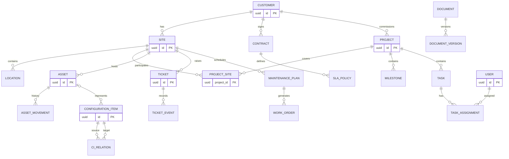
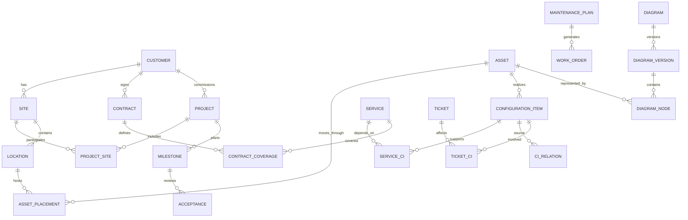

> **v1.4 OVERRIDE (2026-11-18):** This section supersedes earlier UI-specific descriptions when they conflict. See `DESIGN_BASELINE_v1.4.md`.

### v1.4 dashboard alignment
No new core domain entities mandated by visual redesign. Dashboard is an authorized read model derived from projects, milestones, tickets, SLA instances and assignments. Metric definitions and historical snapshots may require additional data modeling after owner approval.

---

# Domain Model & ERD
## Bounded contexts and ownership
Customer owns customer/contact/contract; Site owns physical hierarchy; Project owns delivery tasks/milestones/acceptance; Asset owns physical devices/movements; CMDB owns configuration items and dependencies; Service Desk owns tickets/SLAs; Maintenance owns plans/work orders; Platform owns identities/files/notifications/audit.

## Mermaid ERD (core)

## Identity and relationship rules
UUID primary keys; human-readable immutable codes per entity. Asset != CI != Service. An asset may change site; movements are append-only. Project and site are many-to-many. Tickets may reference multiple CIs via join table. Contract SLA policy is effective-dated. No hard delete for operational entities; use archive/retire.
## Data ownership constraints
Project closure must not delete site/assets. Approved document versions immutable. CI relationships have relationship_type and validity range. Cross-customer associations rejected in domain service and database where practical.

## Baseline assumptions and boundaries
- One operating company, multiple customers and sites; **not SaaS multi-tenant**.
- Customer portal is optional and isolated by customer scope; no direct device administration from portal.
- On-premises or private-cloud deployment; English identifiers, Vietnamese UI labels supported.
- P0 includes project delivery, assets, site, tickets, basic maintenance, reports, email and RBAC; advanced topology editor, telemetry and bidirectional Zalo are later phases.
- All dates persisted UTC with timezone-aware presentation; all important mutations audited.
- Architecture decisions require stakeholder sign-off before production.

---

# v1.1 Domain boundaries and invariants
**Ownership:** Customer domain owns Customer/Site/Contact; Delivery owns Project/Milestone/Acceptance; Infrastructure owns Asset/Placement/CI/Diagram; Service Operations owns Ticket/SLA; Maintenance owns Plan/WorkOrder; Platform owns Identity/Document/Notification/Audit.

**Invariants:** ProjectSite.project.customer_id = Site.customer_id; only one active AssetPlacement per asset; location.site.customer matches asset owner customer; a diagram version is append-only once approved; CI relationship cannot point to itself or create prohibited dependency cycles; customer-scoped ticket/site/CI joins must match customer. Cross-domain changes publish outbox events after commit. Do not use serial as asset PK. Diagram node coordinates are stored against immutable version ID.

---
## v1.3 Visual baseline alignment (2026-11-18)
No domain entities change because of the visual redesign. Dashboard is a read projection across Projects, Tickets, SLA and Work Orders; it must not become a new source of truth.
