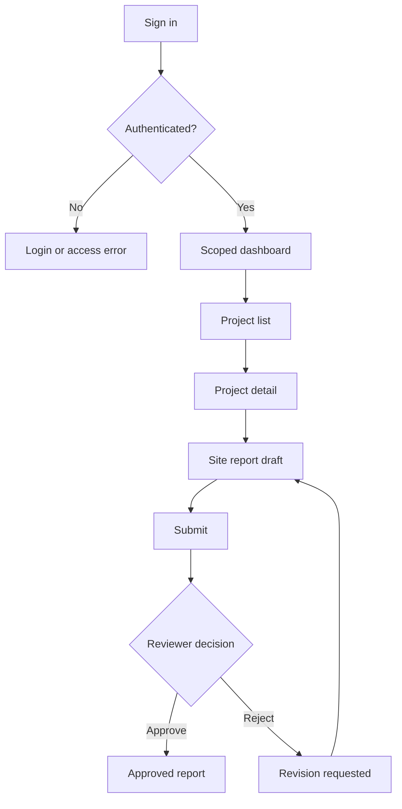
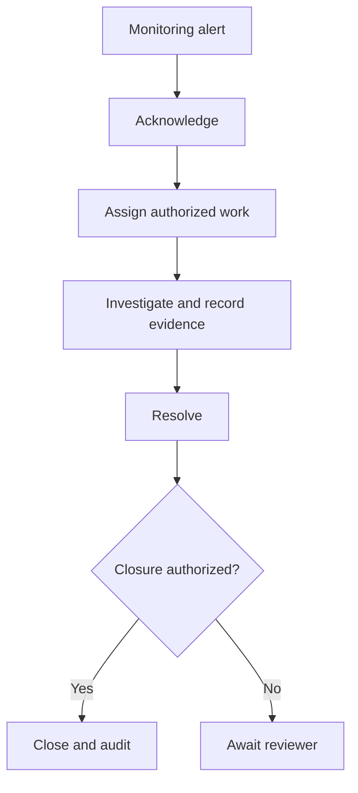

# FDI Project Management — UX Flows & Wireframes v2.0

> Design artifact only. No Figma file or production UI is implied. Baseline: Next.js 16, responsive internal application, 4 business roles, single organization. Approval: TBD.

## 1. Information architecture
- Dashboard (scoped KPIs)
- Customers → Customer detail → Sites
- Projects → Project detail → Milestones, Assignments, Devices, Reports, Documents
- Devices → Inventory, installation history (proposed)
- Alerts → Alert detail → Work / Incident (separation TBD)
- Maintenance → Calendar, checklist, execution
- Works → My tasks, team assignments
- Reports → Draft, submit, review, PDF (subject to approved workflow)
- Admin → Users, teams, roles, audit (strict permissions)

## 2. Main user journeys




## 3. Desktop wireframe
```text
+----------------------+----------------------------------------------+
| Sidebar              | Header: breadcrumbs | search | profile      |
| Dashboard            +----------------------------------------------+
| Customers            | Page title + permitted primary action        |
| Projects             | Scope filters | search | status | date      |
| Devices              | KPI cards / summary (where relevant)         |
| Alerts / Works       | Data table: loading/empty/error/ready       |
| Maintenance          | Row action -> detail drawer/page             |
| Reports              |                                              |
| Admin (authorized)   | Pagination | last updated | help             |
+----------------------+----------------------------------------------+
```

## 4. Mobile wireframe
```text
+--------------------------------+
| Header | title | menu | profile|
+--------------------------------+
| Context summary                |
| Filters (collapsible)          |
| Cards / stacked rows           |
| Primary action (if permitted)  |
| Loading/empty/error state      |
+--------------------------------+
| Dashboard | Projects | More    |
+--------------------------------+
```
Use drawer for secondary navigation; avoid horizontal scrolling for critical actions; tables may scroll only when necessary. Validate keyboard focus, drawer close, and safe-area spacing.

## 5. Screen inventory and states
| Screen | Key states | Core permissions | Acceptance focus |
|---|---|---|---|
| Login | idle, invalid, loading, locked | Public | no sensitive error leakage |
| Dashboard | loading, empty, ready, error | scope read | no cross-scope KPI leakage |
| Project detail | read, edit, submit, denied | project read/write | server-enforced scope |
| Devices | list, create, move, archived | device permissions | serial and history consistency |
| Alert detail | new, acknowledged, active, resolved, closed | alert action-specific | transition validity |
| Site Report | draft, submitted, rejected, approved | report actions | no edits to approved without revision |
| Admin roles | list, preview import, reject, commit | privileged | no self-escalation |

## 6. Reusable components
AppShell, Sidebar, MobileNav, PageHeader, ScopeFilter, DataTable, StatusBadge, FormField, ConfirmDialog, UploadZone, ApprovalTimeline, EmptyState, ErrorState, LoadingSkeleton, Toast, AuditHistory. Reuse primitives; keep business rules within features rather than one giant CRUD component.

## 7. Accessibility and security UX
WCAG 2.2 AA as proposed target (subject to approval): visible focus, keyboard navigation, accessible labels, non-color status cues, dialog focus trap, readable contrast, descriptive validation errors. Confirm destructive actions, mask sensitive fields, never expose forbidden data in preloaded UI payloads.

## 8. Design tokens and assets
Reuse existing color/font tokens where verified; do not assert that CSS tokens or screenshots match production without inspection. Dark mode and PDF preview are backlog unless verified. Use screenshots from the candidate build, never fabricated captures.

## 9. Open decisions
Alert vs Incident; Project–Site relationship; Device lifecycle; Site Report approval chain; mobile bottom navigation; upload limits and allowed formats; Director vs Manager permission nuances. Resolve with Product Owner before high-fidelity design.

## 10. UX handoff checklist
Approved screen inventory; state diagrams; permission-aware UI; responsive layouts; accessibility tests; realistic anonymized data; error/empty/loading states; link to requirement and test IDs; signed review.
