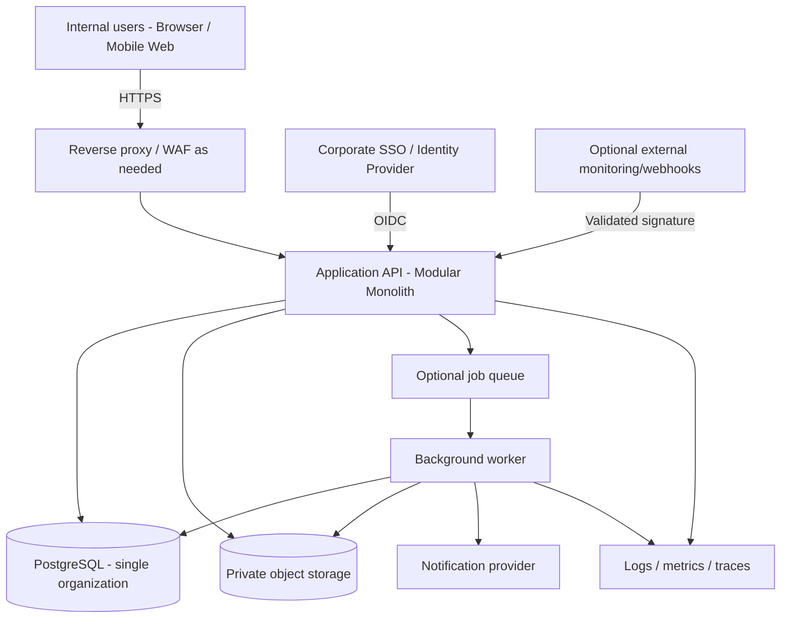

# FDI Project Management — Technical Specification v2.1

**Architecture decision:** Single-Organization Internal Application; **NOT SaaS; NOT Multi-Tenant**  
**Status:** Proposed technical baseline — pending business/engineering approval  
**Audience:** Product Owner, Development Director, Backend, Frontend, DevOps, QA, Security  
**Basis:** `tech_spec.md` v1.0 and previous v2.0; user architecture decision supersedes SaaS assumption.  
**Date:** 2026-11-17

## 1. Executive decision and architectural critique

The original v1.0 listed “SaaS / Subscription” without specifying the corresponding business requirement. v2.0 then proposed tenant-aware entities, memberships, isolation tests, billing considerations and shared-schema tenancy. **These are removed.** Customer records represent **clients managed by the company**, not independent software tenants. Single-organization does not imply unrestricted data access.

| Decision | Recommendation | Status |
|---|---|---|
| Deployment model | One organization, one logical application/database | Confirmed direction |
| Multi-tenancy | No tenant entities, tenant IDs, tenant resolution, tenant RLS | Excluded |
| Billing/subscription | No plans, metering, subscription or tenant provisioning | Excluded |
| Backend | Modular monolith with domain boundaries | Proposed |
| Frontend | Responsive web, Next.js + TypeScript | Proposed |
| API | Node.js + TypeScript, REST + OpenAPI 3.1 | Proposed |
| Database | PostgreSQL with migrations, FKs, constraints | Proposed |
| Files | Private S3-compatible object storage | Proposed |
| Authentication | OIDC-compatible identity provider or approved corporate SSO | Proposed |
| Authorization | RBAC plus project/site assignment checks | Required principle |
| Async processing | Queue/worker only when needed for email, files, integrations | Conditional |

**Out of scope:** tenant billing, cross-tenant access, native mobile application, microservices, AI, comprehensive offline sync, real-time device telemetry ingestion (unless separately approved).

## 2. Business scope and bounded contexts

- **Identity & Access:** user, role, user_project_assignment, user_site_assignment, sessions, authorization policies.
- **Customer:** business customer records and contact information. Customer ≠ SaaS tenant.
- **Project:** project ownership, schedule, progress, status.
- **Site:** physical project locations and site information.
- **Device:** equipment inventory, serial number, assignment, status.
- **Work & Maintenance:** work orders, assignments, scheduled maintenance, outcomes.
- **Alert / Incident:** incidents, severity, priority, acknowledgement, escalation and resolution.
- **Site Report:** draft, submission, review, photo attachments.
- **Document:** private attachments, metadata and download authorization.
- **Dashboard / Audit:** aggregated operational KPIs and traceability.

> DD decision 2026-11-17: Giữ MỘT entity `alerts`; Incident = **trạng thái xử lý của Alert** (render qua `IncidentLifecycle`), KHÔNG phải entity riêng trong v1; tách bảng `incidents` deferred. Dòng "Alert / Incident: incidents..." ở trên là proposal cũ, giữ lại để traceability. (xem DD_DECISIONS_P0.md)

Module boundaries should be enforced in application services; avoid direct writes into another module’s tables except through explicitly defined application contracts.

## 3. Logical architecture

The API communicates independently with PostgreSQL and object storage; PostgreSQL does not act as an intermediary to file storage. For browser direct uploads, use short-lived presigned URLs after authorization. Deploy one logical instance initially; HA and horizontal scaling require capacity evidence.

## 4. Data model (no tenant_id)

| Entity | Key fields (illustrative) | Integrity / ownership |
|---|---|---|
| User | id, identity_subject, name, status | Unique identity subject |
| Role | id, code, description | Controlled permission catalogue |
| UserRole | user_id, role_id | Unique pair |
| ProjectAssignment | user_id, project_id, scope_role | Explicit project access |
| SiteAssignment | user_id, site_id | Optional fine-grained site access |
| Customer | id, code, name, status | Client managed by organization |
| Project | id, customer_id, code, owner_id, status | FK customer; unique project code |
| Site | id, project_id, code, location | FK project; unique (project_id, code) |
| Device | id, project_id, site_id, serial, status | Unique (project_id, normalized_serial); site must belong to project |
| Alert | id, project_id, site_id, severity, priority, status | Valid project/site relationship |
| Work | id, project_id, assignee_id, due_at, status | Assignee authorized for project |
| Maintenance | id, project_id, site_id, scheduled_at, status | Define schedule and completion rules |
| SiteReport | id, project_id, site_id, author_id, progress, status | Controlled transitions |
| Document | id, owner_type, owner_id, object_key, checksum, mime_type | Private file and resource-scoped access |
| AuditEvent | id, actor_id, action, entity_type, entity_id, occurred_at | Append-only, controlled retention |

Use foreign keys, indexes based on measured queries, UTC timestamps, transactional changes, and explicit delete/archive rules. **Do not add tenant_id or Tenant/Membership tables.** For device/project consistency, enforce via composite FK or transactional application validation plus DB constraints where possible. Avoid a polymorphic `owner_type/owner_id` without a clear integrity strategy; separate join tables may be preferable.

> DD decision 2026-11-17: Device serial giữ rule migration đã chạy: `UNIQUE (project_id, serial)` + `UNIQUE (mac_address)` **toàn cục**; `normalized_serial` **chưa có cột** → backlog, không ghi là đã có. Dòng "Unique (project_id, normalized_serial)" trong bảng ở trên là proposal cũ, giữ lại để traceability. (xem DD_DECISIONS_P0.md)

## 5. Authorization and data access

- Authentication establishes **who** the user is; authorization establishes **what resources** they can access.
- Backend enforces **role + action + resource scope** on every request, including list filters, exports, attachments and background jobs.
- Frontend hiding buttons is UX only, never security enforcement.
- Project/site assignment and document classification may narrow permissions even for users with the same role.
- Admin access is privileged and audited; whether Admin bypasses project assignment must be a documented policy.
- Default deny; do not trust project_id, site_id or role values from request bodies as proof of access.

**Permission matrix — requires Product Owner sign-off**

> DD decision 2026-11-17: Đồng bộ về 4 tên canonical — giữ Manager/Leader; **Admin → Director**, **Engineer → Employee**. Giữ cột riêng `system_admin (technical)`: privilege kỹ thuật, cấp explicit + audited, KHÔNG suy từ hierarchy. Bảng Admin/Engineer bên dưới giữ nguyên để traceability. (xem DD_DECISIONS_P0.md)

| Operation | Admin | Manager | Leader | Engineer |
|---|---|---|---|---|
| View assigned projects | Proposed | Proposed | Proposed | Proposed |
| Create/edit project | TBD | TBD | TBD | TBD |
| Assign work | TBD | TBD | TBD | TBD |
| Submit site report | TBD | TBD | TBD | TBD |
| Approve site report | TBD | TBD | TBD | TBD |
| Manage users/roles | TBD | TBD | TBD | TBD |
| View audit logs | TBD | TBD | TBD | TBD |

**Negative test gate:** user without Project B access cannot read, edit, enumerate, export, or download Project B records/files, even by changing an ID in an API request.

## 6. Authentication and security

Prefer corporate SSO/OIDC with MFA for privileged roles. If using browser sessions, apply secure HttpOnly cookies, SameSite/CSRF protections, session expiry and revocation. Enforce HTTPS, least-privilege DB/storage credentials, secrets management, strict CORS, input schema validation, parameterized queries, security headers and sanitized logs. Apply endpoint-sensitive rate limits per identity/IP. Uploads require file size/type checks, content scanning according to risk, private buckets, short-lived download grants and authorization before file access. Validate webhook signatures, replay windows and idempotency when integrations exist. Conduct OWASP ASVS-aligned review prior to production.

## 7. API conventions

**Base path:** `/api/v1`; JSON; OpenAPI 3.1 as source of truth.

| Domain | Initial routes |
|---|---|
| Dashboard | `GET /dashboard/summary` |
| Customer | `GET/POST /customers`, `GET/PATCH /customers/{id}` |
| Project | `GET/POST /projects`, `GET/PATCH /projects/{id}` |
| Site | `GET/POST /sites`, `GET/PATCH /sites/{id}` |
| Device | `GET/POST /devices`, `GET/PATCH /devices/{id}` |
| Alert | `GET/POST /alerts`, `POST /alerts/{id}/transitions` (proposed) |
| Work | `GET/POST /works`, `POST /works/{id}/transitions` (proposed) |
| Maintenance | `GET/POST /maintenance` |
| Site Report | `GET/POST /reports`, `POST /reports/{id}/submit` (proposed) |
| Document | `GET /documents`, `POST /documents/upload-intents` (proposed) |
| Audit | `GET /audit-logs` (privileged) |

Standardize error body (`code`, `message`, `details`, `request_id`), HTTP status meanings, server-side pagination, safe filter/sort allowlists, idempotency for repeated writes, optimistic concurrency on shared edits and resource-scope checks. Do not expose a resource's existence to unauthorized users where inappropriate.

## 8. Business workflows — proposals pending approval

- **Alert:** New → Acknowledged → Assigned → In Progress → Resolved → Closed; controlled reopen/escalation.
- **Work:** Open → Assigned → In Progress → Blocked / Completed → Verified; controlled reopen.
- **Site Report:** Draft → Submitted → Approved / Changes Requested → Resubmitted.
- Every transition records actor, timestamp, old/new status, required reason, permission and version checks.
- SLA clocks, report review roles and notification recipients must be defined by business owners, not invented in code.

## 9. Performance, reliability and operations

**Proposed targets (not guarantees):** typical read API p95 < 500 ms at agreed load; monthly availability 99.9% if justified; 5xx rate < 1% over rolling 30 minutes; RPO <= 24 h and RTO <= 8 h pending approval. Record expected concurrent users, projects, sites, devices, uploads and alert ingestion before capacity planning. Daily encrypted backups, retention policy and restore drills are required; PITR is recommended if loss of up to 24 h is unacceptable. Backup is a recovery function, not a fourth environment.

Use structured logs, correlation IDs, latency/error metrics, DB saturation, queue health, storage capacity and authentication anomalies. Define alert windows, ownership, escalation paths and runbooks. Distinguish operational alerts managed *by the product* from infrastructure alerts *about the product*.

## 10. Environments, CI/CD and release

- Environments: local/development, staging, production; isolate secrets and data.
- Pipeline: lint/typecheck → unit/integration → security/dependency scan → build → staging → E2E/smoke → approval → production → smoke/monitor.
- Database migrations are versioned and reviewed; use backward-compatible expand/migrate/contract patterns when necessary.
- Define rollback/roll-forward strategy and incident owner; prohibit using live customer data in staging without approved anonymization.

## 11. Testing and Definition of Done

| Layer | Acceptance evidence |
|---|---|
| Unit | Validation, state transitions, policy rules |
| Integration | FK/uniqueness, DB transactions, file access, queue retries |
| API | OpenAPI compliance, pagination, errors, concurrency |
| Security | IDOR and cross-project denial, privilege escalation, upload abuse |
| E2E | Customer → Project → Site → Device; Alert; Site Report |
| Performance | Measured load against agreed volume and latency |
| Recovery | Isolated restore test, integrity and RPO/RTO evidence |
| Accessibility | UI/UX spec alignment; WCAG 2.2 AA target |

Done requires reviewed code, passing tests, approved API/schema changes, audit/telemetry for sensitive flows, documentation, and deployment/recovery evidence.

## 12. Delivery plan

**P0 — Foundation:** approve stack, hosting, ERD, project/site permission matrix, API contract, SSO, CI/CD and backup.  
**P1 — Core MVP:** Customer, Project, Site, Device, Work, Alert, Site Report, Document, Dashboard, Audit.  
**P2 — Hardening:** notification integration, exports, load tests, accessibility, recovery drills, security testing and operational runbooks.

## 13. Architecture review blockers

- [ ] Confirm one organization and no SaaS/multi-tenant features.
- [ ] Approve hosting, cost envelope, deployment/network access model.
- [ ] Approve ERD and project/site ownership relationships.
- [ ] Sign off role/action/resource permission matrix.
- [ ] Confirm alert/work/report state machines and SLA rules.
- [ ] Approve API conventions and file access strategy.
- [ ] Confirm scale, data classification, retention and RPO/RTO.
- [ ] Demonstrate staging deployment, security checks and restore test.

## 14. Change log from v2.0

**Removed:** Tenant entity; tenant_id in all entities; tenant memberships; tenant routing/context; tenant RLS; cross-tenant tests; subscription, billing, plans, tenant provisioning, SaaS-only launch requirements.  
**Replaced:** Tenant authorization with role + project/site resource-scope authorization; cross-tenant security tests with cross-project access tests; tenant scaling assumptions with organizational capacity planning.  
**Retained:** modular monolith recommendation, PostgreSQL, private object storage, OpenAPI, audit, security, CI/CD, recovery, operational metrics.  
**Clarified:** Customers are business customers, not software tenants; proposed stack and workflow details still require sign-off.
