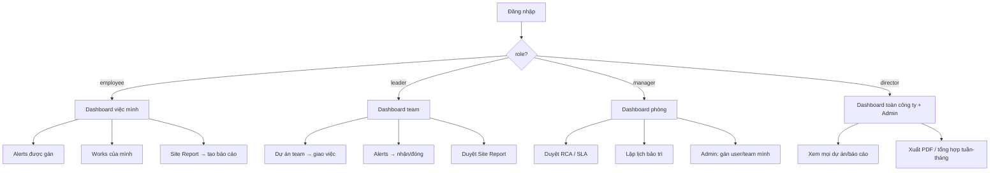

# 🎨 FDI_Project — Wireframe & User Flow (thay cho file Figma)

> Ngày 2026-11-17 · Không có file Figma gốc từ khách. Artifact này mô tả **cấu trúc màn hình & luồng** bằng text/Mermaid để dev và QA đối chiếu (checklist §2 #1–#3).
> Khi có Figma thật, thay file này bằng link + screenshot trong `docs/design/`.

---

## 1. User flow theo role (§2 #1)



## 2. Wireframe layout (§2 #2, #7)

```
Desktop (≥768px)
┌──────────────────────────────────────────────────────┐
│ Sidebar w-60 (collapse → w-16)  │ Header (title,    │
│  Logo FDI_Project                │  email, logout)   │
│  Dashboard / Khách hàng / ...    ├───────────────────┤
│  [Quản trị: manager+director]    │ Main (p-4)        │
│  user card + role                │  KPI cards        │
│                                  │  filter + table   │
│                                  │  modal CRUD       │
└──────────────────────────────────────────────────────┘

Mobile (<768px)
┌──────────────────────┐
│ Header (☰ , title)   │  ☰ → drawer (sidebar trượt từ trái,
├──────────────────────┤     backdrop, Escape/click ngoài đóng)
│ Main (p-4, pb-20)    │
│  KPI cards (1 cột)   │
│  search + filter     │
│  table (scroll ngang)│
├──────────────────────┤
│ Bottom nav (fixed)   │  Dashboard | Dự án | Cảnh báo |
│  Dashboard/Dự án/... │  Báo cáo | Thêm (mở drawer)
└──────────────────────┘
```

## 3. Luồng nghiệp vụ chính (§2 #3)

| # | Luồng | Các bước | Màn hình |
|---|---|---|---|
| 1 | Đăng nhập | email/password → JWT → cookie HttpOnly → redirect callbackUrl | `/login` → `/dashboard` |
| 2 | Chọn dự án | sidebar → Dự án → click row → tabs (devices/reports) | `/projects` |
| 3 | Xử lý sự cố | Alerts → click → timeline → Nhận → Đang xử lý → Giải quyết → Đóng → (tuỳ) Tạo việc | `/alerts/[id]` → `/works` |
| 4 | Báo cáo | Report → xem chi tiết → Xuất PDF (Inter nhúng, tiếng Việt) | `/reports/[id]` |
| 5 | Tổng hợp | Reports → Chọn tuần/tháng → bảng theo loại → Xuất PDF | `/reports/summary` |
| 6 | Soạn thông báo | form → chọn kênh → Tạo nội dung → Sao chép / Mở Zalo-email (KHÔNG tự gửi) | `/notifications` |
| 7 | Export/import quyền | Admin → Xuất JSON → (sửa) → Import JSON → toast | `/admin/roles` |

## 4. Component system (§2 #5) — map sang code

| Figma component | Code | File |
|---|---|---|
| Button (6 variant) | `Button` | `components/ui/ui.tsx` |
| Input / Textarea / Select / Label | `Input`, `Textarea`, `Select`, `Label` |同上 |
| Card / Modal / Tabs / Badge | `Card*`, `Modal*`, `Tabs`, `Badge` |同上 |
| Table | `Table*` + `CrudPage` | `components/crud/CrudPage.tsx` |
| Toast / Spinner / Skeleton / EmptyState | `ToastProvider`, `useToast`, `Spinner`, `Skeleton`, `EmptyState` | `components/ui/ui.tsx` |
| Sidebar / Bottom nav | `ClientBody` | `components/ClientBody.tsx` |

## 5. Style guide token (§2 #4, #13, #14)

- Màu: 12 biến trong `app/globals.css` (`--bg-*`, `--text-*`, `--accent*`, `--success/warning/danger/info`, `--border`).
- Spacing: `--space-1..8` · Radius: `--radius-sm/md/lg` · Duration: `--duration-fast/normal`.
- Font: Inter (`next/font/google`) + fallback system, `lang="vi"`.
- Dark mode: chỉ dark (spec ghi rõ "hiện tại chỉ tối") — §2 #15 để backlog.

## 6. Trạng thái (§2 #8–#12)

- Upload ảnh: chưa có UI upload thật trong report (photo lưu JSONB) → ⏳ cần Supabase Storage ở phase sau.
- Prototype clickable: dùng app chạy local (`npm run dev`) thay vì Figma prototype.
- Dark/Light toggle: chưa có (backlog).

> **Ghi chú cho checklist §2**: các mục #1–#7, #13–#14 có artifact này làm bằng chứng thiết kế; #8–#12 vẫn ⏳ vì thiếu file Figma/upload thật.
